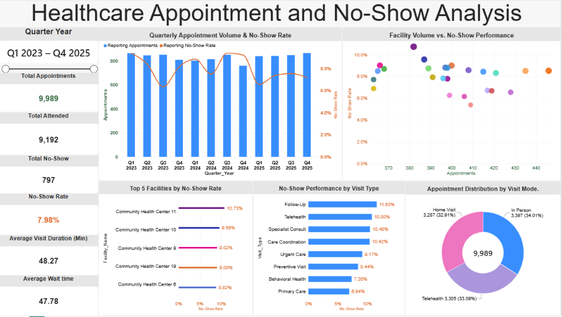

Healthcare Appointment and No-Show Analysis
Microsoft Fabric | PySpark | Lakehouse | Power BI | DAX | Data Modeling

An end-to-end business project demonstrating how synthetic healthcare appointment data can be cleaned, modeled, validated, and visualized to support operational analysis.

## Power BI Dashboard

Interactive Healthcare Appointment and No-Show Analysis developed using Microsoft Fabric and Power BI.

  
Business problem
Healthcare operations teams need reliable visibility into appointment attendance, no-show patterns, facility performance, and differences across visit types. This project builds an interactive reporting solution to investigate those patterns and identify areas for further review.
Solution architecture
Synthetic appointment data → Microsoft Fabric Lakehouse → PySpark transformations / Delta tables → star-schema semantic model → DAX measures → Power BI report.
What I built
- Data preparation: Processed 10,018 synthetic source records and removed 18 duplicates to produce 10,000 unique encounters.
- Fabric Lakehouse: Used a Microsoft Fabric notebook and Delta tables to prepare data for analytics.
- Data quality: Standardized inconsistent visit-type and visit-mode labels and handled text-formatted numeric values.
- Star schema: Modeled factappointments_final with dimdate, dimprovider, dimfacility_clean, and dimdiagnosis.
- DAX and validation: Built reporting-specific KPIs, checked measure totals, and separated 11 out-of-period encounters from the Q1 2023–Q4 2025 reporting window without deleting them.
- Interactive report: Developed quarterly volume/no-show trends, facility performance scatter plots, top-five facility comparisons, visit-type no-show rates, and visit-mode distribution.
Dashboard results (Q1 2023–Q4 2025)
KPI	Result
Reporting appointments	9,989
Attended appointments	9,192
No-shows	797
No-show rate	7.98%
Average visit duration	48.27 minutes
Average wait time	47.78 minutes

Reconciliation: 9,192 attended + 797 no-shows = 9,989 reporting appointments.
Selected findings
- Community Health Center 11 recorded a 10.73% no-show rate in the reporting period.
- Follow-Up visits recorded an 11.63% no-show rate.
- Quarterly comparisons allow stakeholders to explore changes in appointment volume and no-show rates over time.
These are descriptive findings from synthetic data, not evidence of causes or real-world clinical outcomes.
Skills demonstrated
Microsoft Fabric, OneLake/Lakehouse, PySpark, Delta Lake, ETL, dimensional modeling, star schema, DAX, Power BI, data cleaning, KPI reconciliation, data visualization, and analytical communication.
What I learned
A trustworthy dashboard starts well before visualization. Standardizing categories, managing date relationships, validating business measures, and reconciling source-to-report totals are essential to producing useful business intelligence. I value continuous learning, teamwork, and sharing practical lessons with other analysts and developers.
Learning resource
Microsoft Learn — Microsoft Fabric training
